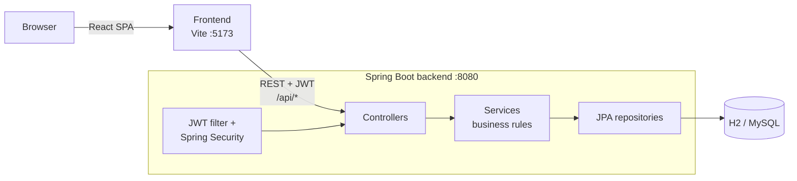
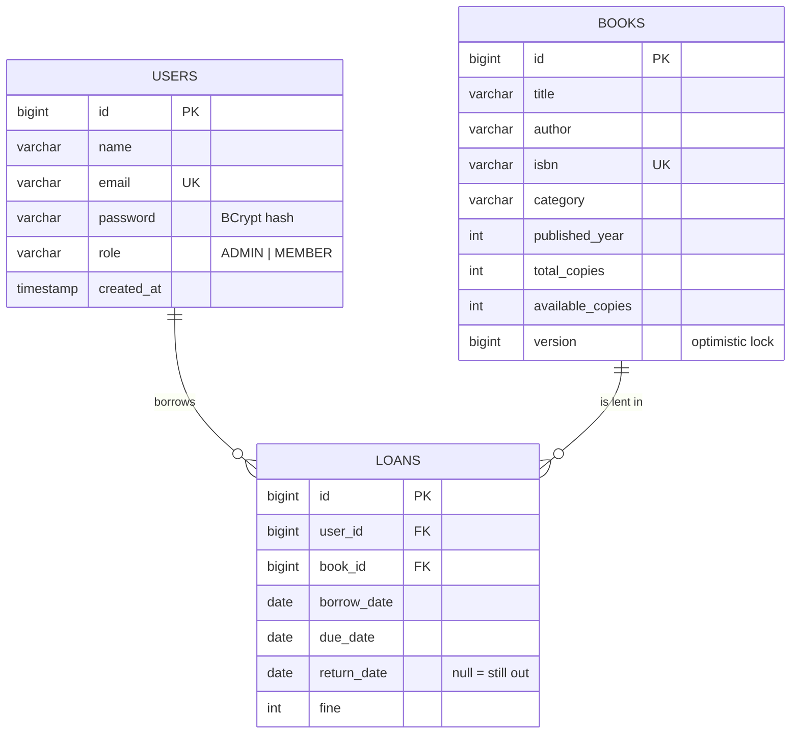

# 📚 Shelfwise: Library Management System

A full-stack web app for running a college library. Members browse the catalogue, borrow books and track due dates. Books are returned at the circulation desk, where a librarian checks them in. Librarians manage the collection, run the circulation desk and see library-wide statistics.

**Backend:** Java 17 · Spring Boot 3 · Spring Security (JWT) · Spring Data JPA · H2 / MySQL
**Frontend:** React 18 · Vite · React Router · Axios

---

## ✨ Features

### For members (students)
- Register and log in (JWT-based authentication)
- Search the catalogue by title, author or ISBN, filter by category, sort, and page through results
- See live availability ("2 of 4 available") and borrow a book in one click
- Personal dashboard: books currently borrowed, due dates, overdue warnings and fines building up
- Loan history with return dates and fines paid

### For librarians (admin)
- Dashboard with library statistics (titles, copies on the shelf, active and overdue loans, fines collected)
- Add, edit and delete books (with validation and duplicate-ISBN checks)
- Circulation desk: view all loans filtered by *on loan / overdue / returned*, and mark books as returned
- Members list with each member's borrowing summary

### Business rules (enforced in the backend)
| Rule | Value |
|------|-------|
| Loan period | 14 days |
| Max books per member at once | 3 |
| Late fine | ₹10 per day |
| Member with an overdue book | cannot borrow more until it is returned |
| Same title twice | not allowed at the same time |
| Book with copies on loan | cannot be deleted; total copies can't go below copies on loan |

All values can be changed in `backend/src/main/resources/application.properties`.

---

## 🏗️ Architecture



The backend follows a layered design: **Controller → Service → Repository → Entity**, with DTOs (Java records) at the API boundary so entities are never exposed directly.

### Database design



### How login works (JWT)
1. The user posts their email and password to `/api/auth/login`.
2. Spring Security checks the password against the BCrypt hash in the database.
3. The server returns a signed JWT (valid for 24 hours).
4. React stores the token and sends it as `Authorization: Bearer <token>` on every request.
5. `JwtAuthFilter` validates the token on each request and sets the logged-in user; role rules (`ADMIN` / `MEMBER`) are applied at both URL and method level (`@PreAuthorize`).

---

## 🚀 Getting started

### Prerequisites
- **Java 17+** (`java -version`)
- **Maven 3.9+** (`mvn -v`), or open the `backend` folder in IntelliJ IDEA, which has Maven built in
- **Node.js 18+** (`node -v`)

### 1. Run the backend
```bash
cd backend
mvn spring-boot:run
```
The API starts at **http://localhost:8080**. On the first run it creates the database and adds demo data automatically.

No database installation is needed: it uses an H2 file database stored in `backend/data/`.
To look inside the database, open **http://localhost:8080/h2-console** and use JDBC URL `jdbc:h2:file:./data/librarydb`, user `sa`, empty password.

> In IntelliJ: open the `backend` folder, wait for Maven to import, then run `LibraryApplication.java`.

### 2. Run the frontend (in a second terminal)
```bash
cd frontend
npm install
npm run dev
```
Open **http://localhost:5173**.

### 3. Log in with a demo account
| Role | Email | Password |
|------|-------|----------|
| Librarian (admin) | `admin@library.com` | `admin123` |
| Student (member) | `student@library.com` | `student123` |
| Student (member, has an overdue book) | `priya@library.com` | `priya123` |

You can also register a new member account from the sign-up page.

### Optional: use MySQL instead of H2
```bash
docker compose up -d          # or use your own MySQL with user root / password root
cd backend
mvn spring-boot:run -Dspring-boot.run.profiles=mysql
```
Database credentials can be set with the `DB_USERNAME` and `DB_PASSWORD` environment variables.

---

## 🧪 Running tests
```bash
cd backend
mvn test
```
- `LoanServiceTest`: unit tests for the borrowing rules (copy availability, loan limit, overdue block, fines) using Mockito and a fixed clock
- `AuthAndBookApiTest`: integration tests that start the app with an in-memory database and call the real endpoints (register, login, role-based access, validation errors)

---

## 📡 REST API

All endpoints except `/api/auth/**` need the header `Authorization: Bearer <token>`.

| Method | Endpoint | Access | Description |
|--------|----------|--------|-------------|
| POST | `/api/auth/register` | Public | Create a member account, returns token |
| POST | `/api/auth/login` | Public | Log in, returns token |
| GET | `/api/users/me` | Logged in | Current user |
| GET | `/api/books?q=&category=&page=&size=&sort=&dir=` | Logged in | Search books (paginated) |
| GET | `/api/books/{id}` | Logged in | Book details |
| GET | `/api/books/categories` | Logged in | List of categories |
| POST | `/api/books` | Admin | Add a book |
| PUT | `/api/books/{id}` | Admin | Update a book |
| DELETE | `/api/books/{id}` | Admin | Delete a book |
| POST | `/api/loans/borrow/{bookId}` | Logged in | Borrow a book |
| POST | `/api/loans/{loanId}/return` | Admin | Check a book in at the desk (fine is calculated) |
| GET | `/api/loans/my` | Logged in | My loans |
| GET | `/api/loans?status=all\|active\|overdue\|returned` | Admin | All loans |
| GET | `/api/dashboard/me` | Logged in | Member dashboard stats |
| GET | `/api/dashboard/admin` | Admin | Library dashboard stats |
| GET | `/api/admin/members` | Admin | Members with borrowing summary |

Errors always come back in the same JSON shape:
```json
{ "status": 400, "error": "Bad Request", "message": "You can borrow at most 3 books at a time", "fieldErrors": null }
```

Example with curl:
```bash
TOKEN=$(curl -s -X POST localhost:8080/api/auth/login -H "Content-Type: application/json" \
  -d '{"email":"student@library.com","password":"student123"}' | sed -E 's/.*"token":"([^"]+)".*/\1/')

curl -s "localhost:8080/api/books?q=java" -H "Authorization: Bearer $TOKEN"
```

---

## 📁 Project structure

```
library-management-system/
├── backend/                         Spring Boot REST API
│   ├── pom.xml
│   └── src/
│       ├── main/java/com/library/
│       │   ├── LibraryApplication.java
│       │   ├── config/              Security, CORS, clock, demo data seeder
│       │   ├── controller/          REST endpoints
│       │   ├── dto/                 Request/response records
│       │   ├── entity/              JPA entities: User, Book, Loan
│       │   ├── exception/           Custom exceptions + global JSON error handler
│       │   ├── repository/          Spring Data JPA repositories
│       │   ├── security/            JWT service, JWT filter, UserDetailsService
│       │   └── service/             Business logic
│       ├── main/resources/          application.properties (+ mysql profile)
│       └── test/java/com/library/   Unit and integration tests
├── frontend/                        React app (Vite)
│   ├── package.json
│   ├── vite.config.js               Dev proxy: /api → localhost:8080
│   └── src/
│       ├── api/                     Axios client + API functions
│       ├── components/              Layout, modals, book cover, badges…
│       ├── context/                 Auth and toast notifications
│       ├── hooks/                   Reusable logic
│       ├── pages/                   Login, Register, Dashboard, Books, Loans, Members
│       └── utils/                   Date and currency formatting
├── docker-compose.yml               Optional MySQL
└── README.md
```

---

## ☁️ Uploading to GitHub

1. Create a new **empty** repository on GitHub (don't add a README there), e.g. `library-management-system`.
2. In this project folder run:
```bash
git init
git add .
git commit -m "Library Management System: Spring Boot + React"
git branch -M main
git remote add origin https://github.com/<your-username>/library-management-system.git
git push -u origin main
```
The `.gitignore` already excludes `node_modules`, `target`, the local database and IDE files.

Tip: add a few screenshots (login, books page, admin dashboard) to a `screenshots/` folder and link them here. It makes the repository look much better.

---

## 🔮 Possible enhancements
- Book reservations / waiting list when all copies are out
- Email reminders before the due date (Spring `@Scheduled` + JavaMail)
- Book cover uploads and barcode scanning
- Online fine payment
- Swagger / OpenAPI documentation (`springdoc-openapi`)
- Deployment: backend on Render/Railway, frontend on Vercel/Netlify (set `VITE_API_URL` and `app.cors.allowed-origins`)

## 🔐 Security notes
- Passwords are hashed with BCrypt; the API never returns them.
- The JWT secret in `application.properties` is for development. For a deployed app set the `JWT_SECRET` environment variable (Base64, at least 32 bytes), e.g. `openssl rand -base64 48`.
- Book stock uses optimistic locking (`@Version`), so two people can't both borrow the last copy at the same moment.
